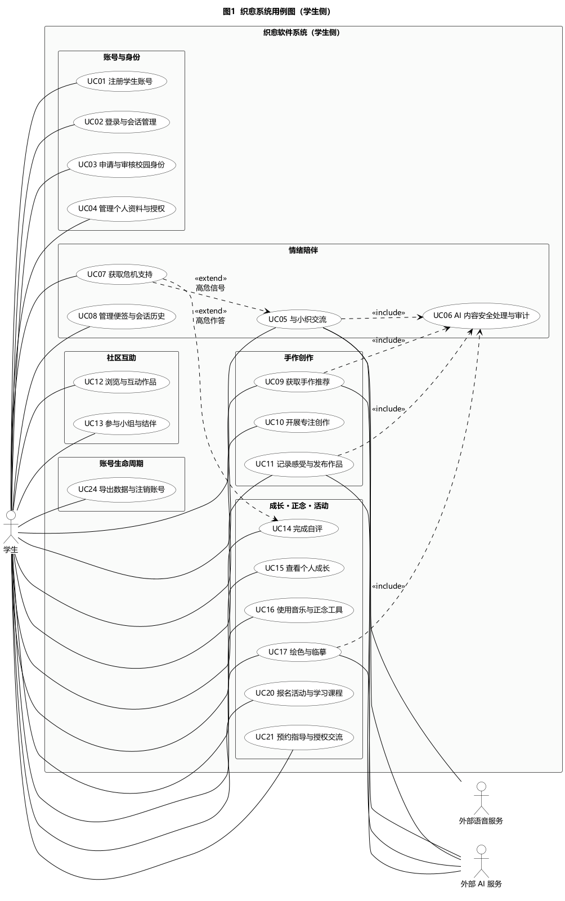
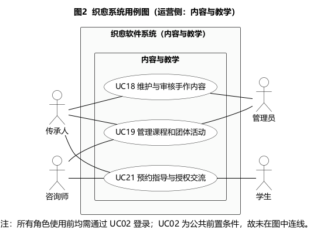
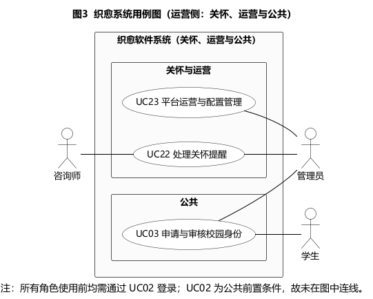

# 织愈系统用例与功能需求

> 文档版本：V1.0  
> 编写日期：2026-10-21  
> 适用场景：江西师范大学人工智能学院校内试用及后续迭代  
> 分析线索：业务目标 → 系统用例 → 可验证的功能需求。

「织愈」是面向大学生的情绪陪伴与非遗手作平台，通过“小织倾听—手作推荐—专注创作—记录与分享”连接日常陪伴、非遗学习和校园支持。学生通过 H5 或微信小程序使用服务，传承人、咨询师和管理员通过管理端开展各自职责范围内的工作。

**本系统不能替代专业心理咨询，不提供医疗诊断、治疗结论或疗效保证。**

---

## 一、系统用例图（System Use Case Diagram）

### 1.1 系统边界

系统边界为**织愈软件系统**，包括学生端、管理端和共用后端提供的业务能力。数据库、缓存、文件存储和系统内部 AI 门面属于内部实现，不作为业务参与者。

学生、传承人、咨询师、管理员均处于系统边界之外。即使管理员负责平台运营，也仍然是操作软件的人，不能画在软件系统内部。外部 AI/语音服务属于协作参与者。

校园统一认证尚未接入，本阶段采用管理员审核校园身份，不将统一认证平台画成已经参与运行的系统。线下心理咨询、现场手作授课和紧急救援属于现实业务，本系统只提供相应的信息、预约或支持入口。

### 1.2 系统参与者

| 参与者 | 主要目标 | 权限边界 |
| --- | --- | --- |
| 学生 | 表达感受、选择手作、学习创作、交流分享、管理本人资料 | 访问本人数据，以及当前受众范围允许访问的内容；不能进入管理业务 |
| 传承人 | 维护非遗项目与教学内容，组织课程，提供预约指导 | 维护本人内容或明确授权协作的活动；不能取得学生私人情绪记录 |
| 咨询师 | 查看脱敏关怀信息，开展授权范围内的跟进或指导 | 不默认获得联系方式和对话正文；联系学生须有单独授权 |
| 管理员 | 管理账号、核验身份、审核内容、协调活动、查看统计和配置 | 按职责管理业务；管理员身份不等于可以旁观私人预约交流 |
| 外部 AI 服务 | 根据系统请求生成对话、推荐理由、寄语或线稿结构 | 不直接与前端交换密钥；输出必须经过系统安全处理 |
| 外部语音服务 | 提供语音识别或语音合成 | 仅在配置有效且用户主动使用时参与；无服务时保留文字路径 |

### 1.3 学生侧系统用例图

以下用 PlantUML 按标准 UML 用例图语法绘制（源文件见 diagrams/，可重新渲染为 PNG/SVG）。小人表示参与者，椭圆表示用例，矩形框为系统边界，实线表示参与关联，虚线箭头分别表示 «include»（包含）与 «extend»（扩展）。为保证可读性，学生侧与运营侧分图展示同一个系统。

> 图1 织愈系统用例图（学生侧）

**学生侧关系要点**：
- 学生（主参与者）与 19 个用例直接关联；
- 外部 AI 服务为 UC05、UC09、UC11、UC17 提供生成能力；外部语音服务为 UC05 提供语音识别；
- «include»：UC05、UC09、UC11、UC17 均包含 UC06「AI 内容安全处理与审计」；
- «extend»：UC07「获取危机支持」在检测到高危信号时扩展 UC05、在自评高危作答时扩展 UC14。

> 图1 学生侧系统用例关系。UC11 中包含安全处理的是 AI 寄语子流程，不表示每次发布都必须成功调用外部模型。UC17 只有选择 AI 线稿时调用 AI，并执行 UC06；内置绘色不要求调用 AI。

### 1.4 运营与管理侧系统用例图

为避免连线过多、难以辨认，运营侧按主题拆为两张图：图2 内容与教学、图3 关怀、运营与公共。

> 图2 织愈系统用例图（运营侧：内容与教学）

**图2 关系要点**：
- 传承人：UC18、UC19、UC21；
- 咨询师：UC19、UC21；
- 管理员：UC18、UC19；
- 学生：UC21。

> 图3 织愈系统用例图（运营侧：关怀、运营与公共）

**图3 关系要点**：
- 咨询师：UC22；
- 管理员：UC22、UC23、UC03；
- 学生：UC03。

**运营侧整体说明**：
- 各角色均通过 UC02 登录；UC02 为公共前置条件，故未在图中连线。
- 合并图2、图3 后，管理员关联 UC03、UC18、UC19、UC22、UC23；咨询师关联 UC19、UC21、UC22；传承人、学生均不参与 UC22、UC23。

> 图2、图3 为运营与管理侧系统用例关系。参与某个用例不代表可以执行其中所有角色的操作；例如管理员审核项目，传承人维护自己提交的项目。咨询师参与活动或指导也必须具备相应主办/协作权限。

**关系说明：**

- 登录是多数业务用例的前置条件，不要求每次查询、评论或播放时重新登录，因此不将所有用例都画成包含 UC02。
- UC06 是 AI 子流程必经的安全能力，不能由普通用户关闭；它不是独立的用户操作页面。
- UC07 可由学生主动发起，也可在 UC05 或 UC14 出现高危信号时扩展执行。
- 图中关联不表示操作顺序；先后步骤在用例规约中定义。

---

## 二、系统术语补充（数据字典·系统层）

| 术语 | 定义 | 说明 |
| --- | --- | --- |
| 小织 | 织愈的陪伴向导形象与对话入口 | 不是咨询师或诊断主体；本阶段保留现有形象 |
| 校园身份核验 | 管理员核对学生提交的校园身份申请并给出结果 | 与账号注册、填写学校名称不同；不等于学校统一认证 |
| 登录会话 | 身份验证后建立的访问状态 | 退出、凭证失效或账号不可用时，不得继续访问受保护资源 |
| 情绪会话 | 学生与小织围绕一次交流形成的对话记录 | 与登录会话不同；支持结束、回看与恢复 |
| 情绪便签 | 学生主动保存的个人感受文字 | 加密保存，默认仅本人可见 |
| 手作项目 | 一项可开展的非遗或手作体验内容 | 包含文化介绍、材料、难度、时长、安全提示与步骤 |
| 创作会话 | 学生对某个手作项目的一次实际创作过程 | 具有待开始、进行中、暂停、完成、放弃等状态 |
| 心流规则 | 根据创作行为触发减少打扰的产品规则 | 不等于对用户心理状态的医学测量 |
| 作品可见范围 | 允许访问作品的受众集合 | 当前采用公开、私密、指定小组等已有范围，不假设存在好友系统 |
| 匿名展示 | 社区页面不向其他普通访问者显示作者身份 | 不等于系统不记录作者归属，也不等于不受审核 |
| 留暖 | 对作品发表友善评论的互动方式 | 评论需安全过滤和审核；不能以“友善”代替权限控制 |
| 私有媒体 | 必须通过访问授权才能读取的图片或视频 | 链接尚未过期也不代表撤权后仍应允许读取 |
| 成长记录 | 本人自评、日常感受、创作记录与趋势的集合 | 仅作自我回顾，不推断诊断或疗效 |
| 回顾式前后感受 | 完成创作后，回忆开始前并填写当下感受 | 不等于开始前独立采集的实时前测 |
| 自评草稿 | 用户在单独同意后保存的未完成量表作答 | 不计算或展示为已完成结果 |
| 团体活动 | 有时间、地点、名额、材料和带领者的校园手作活动 | 模板存在不代表活动已经实际开展 |
| 系列课程 | 由多个课时组成的图文或录播学习内容 | 与需名额管理的现场活动不同 |
| 个别指导预约 | 学生向具有相应权限的带领者申请指导时段 | 预约确认不自动开启私人交流权限 |
| 协作者 | 被活动主办人明确授予活动管理能力的工作角色 | 不能自行把协作权限再授予他人 |
| 关怀提醒 | 安全流程产生的脱敏跟进线索 | 不是医疗诊断；联系方式访问依赖单独授权 |
| AI 审计日志 | 记录 AI 输入输出、安全处置和调用结果的受保护记录 | 敏感正文加密；遵守只追加约束 |
| 降级 | 外部服务不可用时提供缓存理由、图文或文字输入等替代路径 | 必须明确当前能力受限，不冒充真实 AI 返回 |

---

## 三、业务规则与业务约束对照

本文为整理后的规则分配 BR/BC 编号，供本文件追溯使用；不声称这些编号已存在于早期业务需求文档。

### 3.1 业务规则

| 编号 | 规则 | 系统落点 | 功能需求落点 |
| --- | --- | --- | --- |
| BR-01 | 系统只提供陪伴与引导，不提供诊断或治疗承诺；页面可见专业咨询替代限制声明 | UC05、UC07、UC14、UC16 的展示与反馈 | FR-70-01、FR-70-03、FR-80-03 |
| BR-02 | 注册默认学生角色，校园身份另行审核；学校名称不是身份凭证 | UC01 第3步、UC03 | FR-01-01、FR-01-04、FR-80-01 |
| BR-03 | 私人数据仅本人或明确授权范围可访问；管理角色不得任意读取私聊 | UC04、UC08、UC21、UC22、UC24 | FR-01-04、FR-70-02、FR-80-09 |
| BR-04 | 情绪数据处理与咨询师联系分别授权；注册不自动同意，撤回后停止对应处理 | UC04 第2～5步、UC22 第3步 | FR-70-03、FR-80-10 |
| BR-05 | AI 输入输出均需安全处理与审计，高危信号进入支持流程，不生成疏导结论 | UC06；UC05/UC14 扩展 UC07 | FR-10-05、FR-70-01、FR-70-04 |
| BR-06 | 连续5分钟无步骤切换且无主动退出，减少打扰；同一步骤反复停留超过3次且呼吸提醒未响应，提供4秒吸/6秒呼引导 | UC10 备选流3a、3b | FR-30-03、FR-30-04 |
| BR-07 | 用户可暂停、继续或主动结束练习；音频不得默认自动播放 | UC10、UC16 | FR-30-02、FR-80-05 |
| BR-08 | 手作项目及需要审核的社区内容通过审核后才进入对应公开展示范围 | UC11、UC12、UC18、UC23 | FR-40-01、FR-40-02、FR-50-01、FR-60-01 |
| BR-09 | 私密或小组媒体访问以当前权限为准；退组、撤权、下架后拒绝不再授权的访问 | UC12、UC13、UC24 | FR-40-04、FR-80-12 |
| BR-10 | 预约不得超过有效名额，取消释放相应名额；签到与协作操作需校验身份和活动状态 | UC19、UC20 | FR-60-04、FR-80-07 |
| BR-11 | 个别指导交流仅预约双方可访问，由学生单独开启；取消预约或关闭授权后停止新消息 | UC21 第3～5步及备选流 | FR-50-03、FR-80-09 |
| BR-12 | 自评需明确量表版本及计分依据；未完成草稿不参与结果趋势，不混合不同版本分数 | UC14、UC15 | FR-80-03、FR-80-04 |
| BR-13 | 统计以真实记录和明确口径生成；无数据不虚构，回顾式感受不标为实时前测 | UC11、UC15、UC23 | FR-60-03、FR-80-04、FR-80-08 |
| BR-14 | 导出仅含本人允许导出的数据；注销撤销访问并按规则清理，审计与备份不承诺即时全部物理删除 | UC24 | FR-70-04、FR-80-10、FR-80-11 |
| BR-15 | 音乐、图片和教学素材需具备可使用依据并保留来源；不能把品类配图标成实际课程成品 | UC16、UC18、UC19 | FR-50-01、FR-80-05 |

### 3.2 业务约束

| 编号 | 约束 | 系统落点 | 验证落点 |
| --- | --- | --- | --- |
| BC-01 | 普通业务接口 P95 响应时间目标不超过500ms | 查询、保存等普通业务接口 | 第七节性能验收 |
| BC-02 | AI 首字返回目标不超过2s；服务失败仍提供清晰反馈和可用替代路径 | UC05、UC06、UC09 | 第七节外部服务与降级验收 |
| BC-03 | 试点目标支持100名学生同时在线使用 | 全局 | 第七节并发验收 |
| BC-04 | 敏感正文加密、凭据只存服务端；正式部署使用受保护的通信连接 | UC04、UC06、UC08、UC21、UC24 | 第七节安全验收 |
| BC-05 | 网络中断和重复提交不应导致重复预约、重复注册或错误宣称操作成功 | UC01、UC11、UC20、UC21 | 异常流程、并发与恢复测试 |
| BC-06 | 学生端覆盖 H5/微信小程序，管理端覆盖目标桌面浏览器；关键操作有键盘、加载、失败与重试反馈 | 全局 | 第七节兼容与交互验收 |
| BC-07 | 数据和备份保留期限需由运营方明确，撤回、导出和注销说明必须与实际处理一致 | UC04、UC24 | 第七节保留与删除政策评审 |

以上性能数值是既有需求目标，不是本项目当前实测结论。

---

## 四、系统用例规约

规约采用“参与者提出操作—系统校验并反馈”的系统交互视角。除注册、登录及允许公开浏览的入口外，涉及本人数据的操作均要求有效登录；权限在每次业务请求中检查，而非只隐藏菜单。以下流程描述需求行为，部分实现与规划状态以第五节为准。

### UC01：注册学生账号

| 项目 | 内容 |
| --- | --- |
| 用例编号 / 名称 | UC01 / 注册学生账号 |
| 参与者 | 学生 |
| 简述 | 学生创建平台账号，并进入登录后的个人使用流程 |
| 前置条件 | 学生进入注册页面；无需已有平台账号 |
| 后置条件 | 成功时创建学生账号；情绪数据处理和咨询师联系授权均未自动开启 |
| 基本流 | 1. 学生输入登录名、昵称、密码及确认密码，可选填写学校。 2. 系统校验必填项、长度、密码一致性与登录名唯一性。 3. 系统保存账号，使用安全密码存储方式并赋予学生角色。 4. 系统尝试登录新账号。 5. 系统提示成功并进入首页或合法的原访问目标。 |
| 备选流2a：输入不合法 | 系统指出具体字段并保留已填写内容，学生修正后重试。 |
| 备选流2b：登录名已存在 | 系统提示更换登录名或返回登录，不覆盖原账号。 |
| 备选流4a：注册成功、登录失败 | 系统明确“账号已创建”，再次操作仅重试登录，不重复创建账号。 |
| 备选流3a：注册响应中断 | 系统说明结果尚未确认，不武断提示注册成功或失败；提供尝试登录或重试入口。 |

### UC02：登录与会话管理

| 项目 | 内容 |
| --- | --- |
| 用例编号 / 名称 | UC02 / 登录与会话管理 |
| 参与者 | 学生、传承人、咨询师、管理员 |
| 简述 | 用户完成身份验证，按角色进入对应功能并管理登录状态 |
| 前置条件 | 用户拥有有效账号，已进入对应登录入口 |
| 后置条件 | 成功时建立访问状态；退出或失效时清除凭证，受保护访问被拒绝 |
| 基本流 | 1. 用户输入账号和密码并提交。 2. 系统校验凭据和账号状态。 3. 系统建立会话并加载角色允许的功能。 4. 系统跳转到对应首页或经过校验的返回目标。 5. 用户退出时，系统清除本地访问凭据并返回登录页。 |
| 备选流2a：凭据错误 | 系统返回账号或密码错误，不泄露密码，不展示受保护数据。 |
| 备选流2b：账号不可用 | 系统拒绝访问并提示处理方式。 |
| 备选流2c：连续失败【待实现】 | 系统按经确认的限制策略暂时限制尝试并提示恢复条件；次数、窗口和解锁规则见第七节。 |
| 备选流3a：学生进入管理端 | 系统拒绝管理访问，提示使用学生端，不因知道地址而授予权限。 |
| 备选流4a：本地凭证已失效 | 系统校验失败后清除凭证并留在登录页，不在首页与登录页之间反复跳转。 |

### UC03：申请与审核校园身份

| 项目 | 内容 |
| --- | --- |
| 用例编号 / 名称 | UC03 / 申请与审核校园身份 |
| 参与者 | 学生、管理员 |
| 简述 | 学生提交校园身份申请，管理员给出核验结果 |
| 前置条件 | 学生已登录；审核者具有管理员权限 |
| 后置条件 | 系统保存申请及处理结果，学生能够查看状态 |
| 基本流 | 1. 学生打开校园身份页面。 2. 系统展示所需信息、用途与当前申请状态。 3. 学生填写并提交申请。 4. 系统校验后标记待审核。 5. 管理员查看申请并作出通过或驳回处理。 6. 系统保存结果，学生查询时展示状态及允许展示的处理说明。 |
| 备选流3a：资料缺失或已有待审申请 | 系统提示补齐信息或查看现有申请，不产生重复待审记录。 |
| 备选流5a：审核不通过 | 系统保留处理结果，学生按规则补充或重新申请。 |
| 范围说明 | 填写学校不视为核验通过；当前不依赖学校 SSO，未来接入需另行确认身份映射规则。 |

### UC04：管理个人资料与授权

| 项目 | 内容 |
| --- | --- |
| 用例编号 / 名称 | UC04 / 管理个人资料与授权 |
| 参与者 | 学生；其他用户在本人账号范围内管理资料 |
| 简述 | 用户维护个人资料、修改密码，并单独选择隐私及联系授权 |
| 前置条件 | 用户已登录 |
| 后置条件 | 成功修改的资料或授权生效；拒绝授权不被当成同意 |
| 基本流 | 1. 用户进入个人资料或隐私设置。 2. 系统展示当前资料、数据用途、授权状态及撤回影响。 3. 用户修改允许维护的资料，或单独开启/关闭相应授权。 4. 系统验证并保存变更。 5. 系统刷新状态，后续请求按新授权处理。 |
| 备选流3a：修改密码 | 系统核验原密码与新密码要求，成功后提示结果；这不同于忘记密码找回。 |
| 备选流3b：不同意或撤回 | 系统停止对应受保护处理，保留符合当前权限的使用路径；已发生数据的处理按隐私规则执行。 |
| 备选流4a：保存失败 | 系统提示失败并保留用户输入，不把未保存的开关状态显示为已生效。 |

### UC05：与小织进行情绪交流

| 项目 | 内容 |
| --- | --- |
| 用例编号 / 名称 | UC05 / 与小织进行情绪交流 |
| 参与者 | 学生；外部 AI 服务、外部语音服务为协作参与者 |
| 包含 / 扩展点 | 包含 UC06；出现高危信号时扩展 UC07 |
| 前置条件 | 学生已登录并同意相关数据处理；会话属于本人且可继续交流 |
| 后置条件 | 合法交流记录按隐私规则保存；学生得到安全回应或明确的降级提示 |
| 基本流 | 1. 学生开启或恢复一次会话。 2. 学生输入文字，或主动使用已配置的语音识别生成待发送文字。 3. 系统通过 UC06 检查输入并请求回应。 4. 系统对输出执行安全处理，以流式方式展示可输出内容。 5. 学生继续交流，或主动结束会话。 |
| 备选流2a：无语音配置/录音被拒绝 | 系统说明语音暂不可用，保留文字输入，不伪造识别结果。 |
| 备选流3a：高危信号 | 执行 UC07，提供支持入口及适当安全回应，不生成诊断或治疗结论。 |
| 备选流4a：超时或断流 | 系统停止等待并显示失败/降级说明，保留可恢复内容，允许重试。 |
| 备选流5a：生成整段小结【部分实现】 | 目标为安全概括整段交流；当前结束内容留存不等于独立生成完整会话小结。 |

### UC06：执行 AI 内容安全处理与审计

| 项目 | 内容 |
| --- | --- |
| 用例编号 / 名称 | UC06 / 执行 AI 内容安全处理与审计 |
| 参与者 | 无独立发起者，由包含它的 AI 业务子流程触发 |
| 包含于 | UC05、UC09；UC11 的 AI 寄语与 UC17 的 AI 线稿子流程 |
| 前置条件 | 对应业务已通过身份、数据授权及输入格式检查 |
| 后置条件 | 返回允许展示的内容或安全/降级结果，并记录调用与处置结果 |
| 基本流 | 1. 系统接收业务提供的必要输入及上下文。 2. 系统检查输入安全性和调用状态。 3. 系统在允许调用时请求相应 AI 能力。 4. 系统检查输出，阻止不允许的内容继续展示。 5. 系统加密保存敏感审计正文并记录处置结果。 6. 系统将结果交回原业务用例，由原用例反馈给用户。 |
| 备选流2a/4a：安全规则命中 | 返回安全提示或危机支持信号，不返回违规结论；记录处置。 |
| 备选流3a：外部服务不可用 | 返回可识别的降级结果；不同能力分别记录失败，不相互误伤。 |
| 特殊要求 | 按能力资源隔离熔断，连续失败5次熔断60秒；不允许普通用户绕过安全处理。 |

### UC07：获取危机支持

| 项目 | 内容 |
| --- | --- |
| 用例编号 / 名称 | UC07 / 获取危机支持 |
| 参与者 | 学生 |
| 触发方式 | 学生主动寻求支持；或 UC05、UC14 检测到高危信号 |
| 前置条件 | 学生进入支持入口，或系统检测到需要安全分流的情况 |
| 后置条件 | 学生能够查看经维护的支持信息；触发条件满足时生成脱敏关怀线索 |
| 基本流 | 1. 学生请求支持，或系统提示进入支持流程。 2. 系统显示温和安全提示及“不替代专业心理咨询”声明。 3. 系统展示经核验的校园支持指引与求助渠道。 4. 学生自主选择查看、复制或拨打支持联系方式。 5. 对需要跟进的事件，系统按授权和安全规则记录脱敏提醒，供 UC22 处理。 |
| 备选流4a：设备不能拨号 | 系统保留可阅读或复制的联系信息，不把按钮点击记录为已获得帮助。 |
| 备选流3a：渠道未核实或已失效 | 系统不展示编造号码；运营方更新核实信息，保留其他有效支持路径。 |
| 范围说明 | 不保证自动联系到工作人员，不替代紧急救援；不得因安全分流默认开启咨询师联系授权。 |

### UC08：管理便签与会话历史

| 项目 | 内容 |
| --- | --- |
| 用例编号 / 名称 | UC08 / 管理便签与会话历史 |
| 参与者 | 学生 |
| 前置条件 | 已登录，具备相应隐私授权 |
| 后置条件 | 便签按权限保存或处理；查询仅返回本人记录；继续交流时恢复对应会话 |
| 基本流 | 1. 学生选择记录便签或查看历史。 2. 系统展示本人记录或输入区域。 3. 学生提交便签，或选择一条历史会话。 4. 系统验证归属后保存便签或读取历史正文。 5. 学生选择继续交流时，系统校验并转入 UC05。 |
| 备选流2a：无记录 | 系统显示空状态和开始记录入口，不生成示例记录冒充本人数据。 |
| 备选流4a：越权或记录不存在 | 系统拒绝读取，不泄露其他人的正文。 |
| 备选流4b：历史加载失败 | 系统提供重试；历史上下文未恢复前，不把发送操作当作已正确续接。 |

### UC09：获取手作推荐

| 项目 | 内容 |
| --- | --- |
| 用例编号 / 名称 | UC09 / 获取手作推荐 |
| 参与者 | 学生；外部 AI 服务为协作参与者 |
| 包含 | 个性化 AI 理由生成过程包含 UC06 |
| 前置条件 | 推荐所需身份与数据授权有效；存在可供选择的内容 |
| 后置条件 | 返回可访问的手作项目及理由，或明确空结果/降级状态 |
| 基本流 | 1. 学生请求推荐，或从交流后的入口进入。 2. 系统按允许使用的上下文、项目状态和材料安全规则筛选。 3. 系统结合规则与知识检索组织候选内容，并通过 UC06 生成推荐理由。 4. 系统展示项目介绍、难度、预计时长、材料、安全提示和理由。 5. 学生查看详情并选择进入 UC10。 |
| 备选流3a：AI 不可用 | 系统使用缓存或图文理由，标明降级，仍允许查看有效项目。 |
| 备选流2a：无合适项目 | 系统说明当前无结果并提供浏览其他内容的路径，不虚构项目。 |
| 备选流5a：项目已下架 | 系统说明不可继续并提供返回入口，不创建无效创作。 |

### UC10：开展专注创作

| 项目 | 内容 |
| --- | --- |
| 用例编号 / 名称 | UC10 / 开展专注创作 |
| 参与者 | 学生 |
| 前置条件 | 学生已选择有效项目，可访问其步骤 |
| 后置条件 | 创作进度和状态正确保存；完成后可进入 UC11 |
| 基本流 | 1. 学生确认材料和安全提示，开始或恢复创作。 2. 系统展示当前步骤的图文及可用音视频。 3. 学生按引导操作，切换步骤或主动播放引导内容。 4. 系统记录进度与状态，提供暂停、继续、完成和放弃入口。 5. 学生确认完成，系统保存结束状态并提供记录感受或发布作品入口。 |
| 备选流3a：达到心流规则 | 系统减少打扰，不弹出无关交互。 |
| 备选流3b：达到焦躁提醒规则 | 系统提供4秒吸/6秒呼引导；学生可停止或返回创作。 |
| 备选流3c：音视频不可播放 | 系统提示问题并保留图文步骤；不把播放失败当作步骤完成。 |
| 备选流4a：非法状态操作 | 系统拒绝错误流转并展示实际状态，例如已结束记录不能直接继续计时。 |
| 备选流4b：中断后重入 | 系统查询可恢复进度，避免仅因刷新重复创建隐藏会话。 |

### UC11：记录感受与发布作品

| 项目 | 内容 |
| --- | --- |
| 用例编号 / 名称 | UC11 / 记录感受与发布作品 |
| 参与者 | 学生；外部 AI 服务为寄语协作参与者 |
| 前置条件 | 学生已登录；关联创作和待上传媒体属于本人；保存感受需对应授权 |
| 后置条件 | 感受仅按本人隐私范围保存；作品按审核状态及受众范围展示 |
| 基本流 | 1. 学生完成创作后选择记录或直接进入发布。 2. 学生填写作品名称、当下感受及可选情绪词/回顾感受，并选择是否保存。 3. 学生添加作品文字、图片或视频，选择匿名展示和可见范围。 4. 系统验证内容、媒体归属、范围与当前权限。 5. 需要生成寄语时，系统经 UC06 获取安全寄语或降级内容。 6. 系统保存作品并明确告知审核/展示状态。 |
| 备选流2a：不愿记录感受 | 系统允许跳过，不强迫披露私人情绪。 |
| 备选流4a：上传失败或格式超限 | 系统指出原因并保留可恢复的文字，不将失败上传显示为已发布。 |
| 备选流5a：AI 寄语不可用 | 系统使用明确的替代提示，不因 AI 失败丢失作品输入。 |
| 备选流6a：待审或未通过 | 系统显示真实状态，内容不得绕过审核公开。 |
| 特别说明 | 完成后回忆的“开始前感受”须标为回顾式记录，不作为实时前测。 |

### UC12：浏览与互动作品

| 项目 | 内容 |
| --- | --- |
| 用例编号 / 名称 | UC12 / 浏览与互动作品 |
| 参与者 | 学生 |
| 前置条件 | 作品属于当前允许访问的受众范围；互动操作需登录 |
| 后置条件 | 查询不修改作品；点赞、收藏或评论按操作结果保存，未审核评论不直接公开 |
| 基本流 | 1. 学生浏览作品列表并选择作品。 2. 系统核验作品状态、受众与媒体访问权限，展示详情。 3. 学生选择点赞、收藏、留暖或主动分享。 4. 系统校验操作并处理互动；评论执行安全过滤及审核规则。 5. 系统显示保存结果或待审提示。 |
| 备选流2a：下架、私密或已无权限 | 系统拒绝展示受保护内容，不因持有旧链接放行。 |
| 备选流4a：重复或不当互动 | 系统保持正确的点赞/收藏状态，拒绝不合规评论并给出提示。 |
| 备选流3a：未登录 | 系统引导登录；仅保留允许的内部返回目标，不接受任意外部跳转。 |

### UC13：参与互助小组与结伴

| 项目 | 内容 |
| --- | --- |
| 用例编号 / 名称 | UC13 / 参与互助小组与结伴 |
| 参与者 | 学生 |
| 前置条件 | 学生已登录，小组处于可访问状态 |
| 后置条件 | 成员关系或结伴关系正确更新，组内内容按当前成员资格访问 |
| 基本流 | 1. 学生浏览主题小组并选择加入。 2. 系统验证条件并更新成员关系。 3. 学生查看组内信息和作品墙，按规则分享作品。 4. 学生向允许的其他成员发送搭子邀请。 5. 被邀请者接受或拒绝，系统更新关系并反馈。 |
| 备选流2a：小组关闭或不满足加入条件 | 系统说明原因，不创建无效成员关系。 |
| 备选流4a：邀请本人、重复邀请或对方已退出 | 系统拒绝无效操作，提示刷新状态。 |
| 备选流5a：退出/取消结伴 | 系统更新关系并撤销相关访问资格；退组后不能继续读取组内受保护媒体。 |

### UC14：完成自评与保存草稿

| 项目 | 内容 |
| --- | --- |
| 用例编号 / 名称 | UC14 / 完成自评与保存草稿 |
| 参与者 | 学生 |
| 扩展点 | 出现规定的高危作答信号时扩展 UC07 |
| 前置条件 | 学生已登录；所选量表已开放且有明确版本和计分依据 |
| 后置条件 | 单独授权后保存草稿或完整结果，仅用于本人回顾，不输出诊断 |
| 基本流 | 1. 学生选择量表。 2. 系统展示来源、版本、用途、限制及保存授权。 3. 学生同意后逐题作答，可选择保存进度。 4. 系统校验量表版本和答案完整性。 5. 完整作答按既定规则计分，系统展示分数、参考区间与非诊断说明。 6. 学生进入 UC15 查看历史。 |
| 备选流3a：保存草稿 | 系统保存已答内容，下次可继续；草稿不当作完整结果。 |
| 备选流3b：规定高危项命中 | 系统转入 UC07，不用普通分数结果代替安全分流。 |
| 备选流4a：缺题或版本不匹配 | 系统提示补答或重新选择，不错误计分。 |
| 范围说明 | 当前开放 PHQ-9/GAD-7；PSS-10/PANAS/GSES 待核实中文版本、授权与计分依据。 |

### UC15：查看个人成长记录

| 项目 | 内容 |
| --- | --- |
| 用例编号 / 名称 | UC15 / 查看个人成长记录 |
| 参与者 | 学生 |
| 前置条件 | 学生已登录并具备相应数据访问授权 |
| 后置条件 | 展示本人真实记录与统计，不形成诊断或疗效结论 |
| 基本流 | 1. 学生进入成长旅程并选择日期或范围。 2. 系统读取本人心情、自评、创作与感受记录。 3. 系统展示月历、趋势、创作次数、专注时长及符合条件的纪念徽章。 4. 学生选择某条记录，系统显示对应详情。 |
| 备选流2a：无记录或未记录日期 | 系统标明空白，不将无数据解释为状态良好、状态差或零分。 |
| 备选流3a：不同量表/版本 | 系统分组展示，不拼成同一分数曲线。 |
| 备选流3b：回顾式感受 | 系统明确标注回顾性质，不称为实时前后测。 |

### UC16：使用音乐与正念工具

| 项目 | 内容 |
| --- | --- |
| 用例编号 / 名称 | UC16 / 使用音乐与正念工具 |
| 参与者 | 学生 |
| 前置条件 | 学生打开工具页面；音频资源及设备能力满足所选操作 |
| 后置条件 | 音频或练习按用户操作暂停/结束，不承诺医疗效果 |
| 基本流 | 1. 学生选择音乐、呼吸或五感练习。 2. 系统展示简介、音频来源/署名或练习说明。 3. 学生主动开始，系统播放或展示节奏引导。 4. 学生调整允许的音量、进度、时长，或主动暂停。 5. 到达定时条件或离开页面时，系统按约定暂停或停止并反馈。 |
| 备选流3a：播放失败/平台不支持 | 系统说明受限原因并保留其他工具入口，不显示虚假播放状态。 |
| 备选流4a：学生感到不适 | 学生可立即停止，不要求完成计时或打卡。 |
| 范围说明 | 合成白噪音目前为 H5 能力；不把它描述成小程序已经具备同等音频能力。 |

### UC17：进行数字绘色与临摹

| 项目 | 内容 |
| --- | --- |
| 用例编号 / 名称 | UC17 / 进行数字绘色与临摹 |
| 参与者 | 学生；外部 AI 服务为可选协作参与者 |
| 前置条件 | 学生打开绘色页面；使用 AI 时满足登录与授权条件 |
| 后置条件 | 学生获得本地绘色/预览结果；相机画面不因开启临摹而自动上传 |
| 基本流 | 1. 学生选择内置纹样。 2. 系统展示可绘色区域和颜色工具。 3. 学生涂色、撤销或重做。 4. 学生选择预览保存，或进入临摹辅助。 5. 临摹时学生主动开启相机或选择本地图片，系统叠加可调整的线稿。 |
| 备选流1a：选择 AI 线稿 | 学生输入主题并单独同意，系统经 UC06 返回受约束几何结构；失败时保留内置模板。 |
| 备选流3a：更换已有绘色内容 | 系统提示当前颜色可能清空，由学生确认后执行。 |
| 备选流5a：相机拒绝/不支持 | 系统说明原因并提供空白画布或本地图片路径。 |
| 范围说明 | 当前为平面叠加，不具备真实空间锚定；线稿参数生成不等于任意图像生成。 |

### UC18：维护与审核手作内容

| 项目 | 内容 |
| --- | --- |
| 用例编号 / 名称 | UC18 / 维护与审核手作内容 |
| 参与者 | 传承人、管理员 |
| 前置条件 | 工作账号有效；维护者有对应内容权限，审核者具备审核权限 |
| 后置条件 | 内容保存为实际状态，通过审核的项目可在允许范围展示 |
| 基本流 | 1. 传承人新建或编辑本人项目。 2. 系统提供文化介绍、分类、材料、安全等级、难度、时长与步骤字段。 3. 传承人维护配图、图文和视频，登记素材来源，提交审核。 4. 系统校验必填项、媒体和权限，进入待审。 5. 管理员查看内容并通过或驳回。 6. 系统保存结果并按状态控制展示。 |
| 备选流3a：上传失败 | 系统说明原因，不把空链接当作上传成功。 |
| 备选流4a：越权修改/状态不允许 | 系统拒绝操作，保留原有效数据。 |
| 备选流5a：驳回 | 系统记录处理说明，维护者按允许的流程修改后再提交。 |
| 待补能力 | 当前步骤音频可填地址并播放，但独立音频文件上传、校验与清理闭环尚待补齐。 |

### UC19：管理课程和团体活动

| 项目 | 内容 |
| --- | --- |
| 用例编号 / 名称 | UC19 / 管理课程和团体活动 |
| 参与者 | 传承人、咨询师、管理员，依主办/协作权限参与 |
| 前置条件 | 有效工作账号具备相应管理权限 |
| 后置条件 | 活动或课程内容、课时、名额、协作者及处理状态正确保存 |
| 基本流 | 1. 主办人选择工作坊、系列课程或个别指导类型。 2. 主办人维护适用的时间、地点、人数、材料、介绍或课时内容。 3. 系统校验后保存/发布。 4. 主办人按规则添加有效协作者。 5. 获授权人员查看参与信息并处理签到、课时或反馈。 |
| 备选流2a：时间/容量等参数错误 | 系统指出错误，不发布不完整活动。 |
| 备选流4a：协作者再授权 | 系统拒绝，只有有权主办者能够授予相应权限。 |
| 备选流5a：活动取消或下架 | 系统展示实际状态并阻止新的无效报名；既有参与记录按业务规则保留。 |
| 范围说明 | 系列录播满足原“直播或录播”中的录播方案；不据此宣称已提供直播。 |

### UC20：报名活动与学习课程

| 项目 | 内容 |
| --- | --- |
| 用例编号 / 名称 | UC20 / 报名活动与学习课程 |
| 参与者 | 学生；活动管理人员负责签到等对应操作 |
| 前置条件 | 学生已登录，目标内容处于允许参与的状态 |
| 后置条件 | 报名、取消、签到或学习进度正确保存，不因重试重复占用名额 |
| 基本流 | 1. 学生查看活动或课程详情。 2. 系统展示时间、地点、材料、容量或课时安排。 3. 学生确认报名，系统核验状态和剩余名额。 4. 系统保存参与记录并展示结果。 5. 学生参加活动或进入课时学习；有权人员处理签到。 6. 学生按允许条件提交活动反馈。 |
| 备选流3a：已报名、名额不足或已截止 | 系统返回实际结果，不重复占位或超额确认。 |
| 备选流4a：响应中断 | 系统允许查询实际报名状态，不把重复点击变成重复报名。 |
| 备选流5a：取消报名 | 系统校验取消条件，成功后释放相应名额并更新状态。 |
| 备选流5b：教学视频不可用 | 系统提示重试，保留图文内容，不错误记录为已完成学习。 |

### UC21：预约指导与授权交流

| 项目 | 内容 |
| --- | --- |
| 用例编号 / 名称 | UC21 / 预约指导与授权交流 |
| 参与者 | 学生、具有对应权限的传承人或咨询师 |
| 前置条件 | 双方账号有效，存在可预约的指导时段 |
| 后置条件 | 预约及交流授权状态正确保存；私人消息只供双方在允许范围访问 |
| 基本流 | 1. 学生查看带领者介绍及指导时段并申请预约。 2. 带领者查看申请，确认后系统更新预约状态。 3. 学生单独开启该预约的交流权限。 4. 双方进入交流页面发送消息，系统检查参与关系、内容安全和当前授权后保存。 5. 系统展示消息及历史，作者可按规则撤回本人消息。 |
| 备选流2a：预约未确认 | 系统显示等待状态，不提前开放已确认预约的交流功能。 |
| 备选流3a：未开启授权 | 系统拒绝发送；预约确认不代表自动同意私人交流。 |
| 备选流4a：关闭授权或取消预约 | 系统停止新消息写入，按当前规则展示可查看历史；重新预约需重新授权。 |
| 备选流4b：第三方访问 | 即使是管理员，也不能仅凭角色读取双方私聊。 |

### UC22：处理关怀提醒

| 项目 | 内容 |
| --- | --- |
| 用例编号 / 名称 | UC22 / 处理关怀提醒 |
| 参与者 | 咨询师、管理员 |
| 前置条件 | 用户具备关怀处理权限，系统存在可访问提醒 |
| 后置条件 | 提醒处理状态及授权范围内的跟进记录保存，不向无权人员泄露身份或正文 |
| 基本流 | 1. 工作人员进入关怀页面并选择筛选条件。 2. 系统展示允许访问的脱敏摘要和处理状态。 3. 工作人员查看可执行操作；需要联系学生时，系统校验其单独授权。 4. 有权人员在允许范围内登记处理信息并更新状态。 5. 系统保存操作结果，供后续跟进。 |
| 备选流2a：无提醒 | 系统展示空状态，不生成虚假高危数据。 |
| 备选流3a：无联系授权 | 系统不提供对应身份/联系能力；仍可按脱敏职责处理提醒。 |
| 备选流4a：权限或状态变化 | 系统拒绝无效更新并提示刷新，不覆盖其他人员已经完成的处理。 |
| 范围说明 | 线下咨询和救援不是软件执行结果；点击处理不代表已经完成专业干预。 |

### UC23：开展平台运营与配置管理

| 项目 | 内容 |
| --- | --- |
| 用例编号 / 名称 | UC23 / 开展平台运营与配置管理 |
| 参与者 | 管理员 |
| 前置条件 | 管理员已登录，具有相应管理权限 |
| 后置条件 | 所选管理操作结果保存并可追溯；统计查询不改变业务记录 |
| 基本流 | 1. 管理员进入工作台，选择账号管理、内容审核、运营统计或运行配置。 2. 系统展示对应待办、列表、真实统计或当前配置。 3. 管理员选择对象并执行允许的账号处理、审核、筛选或配置修改。 4. 系统校验权限、参数和当前状态后处理。 5. 系统反馈结果，管理写操作保留操作记录。 |
| 备选流2a：统计无数据 | 系统显示零值或无数据状态，不使用虚构数据冒充运营结果。 |
| 备选流4a：配置已被他人修改 | 系统拒绝覆盖旧版本，要求刷新后重新确认。 |
| 备选流4b：试图修改安全底线或填写前端密钥 | 系统不允许普通业务配置绕过安全处理；密钥不作为前端可读配置下发。 |
| 范围说明 | 现有趋势和创作完成占比不等于严格的跨阶段闭环率；闭环率及心流时长占比须先定义口径再实现。 |

### UC24：导出本人数据与注销账号

| 项目 | 内容 |
| --- | --- |
| 用例编号 / 名称 | UC24 / 导出本人数据与注销账号 |
| 参与者 | 学生；其他用户在本人账号允许范围内适用 |
| 前置条件 | 用户已登录；注销须明确二次确认 |
| 后置条件 | 导出不泄露他人数据；注销后账号不可继续使用，相关内容按规则撤权及清理 |
| 基本流A：导出 | 1. 用户选择需要导出的本人数据类别。 2. 系统校验归属，按分页读取允许导出的记录。 3. 系统提供数据副本；需要原媒体时，另行核验并提供保存入口。 4. 系统提示导出范围和保存结果。 |
| 基本流B：注销 | 1. 用户阅读注销影响并明确确认。 2. 系统停止账号访问，处理本人资料、作品、关系和参与记录。 3. 系统撤销受保护媒体访问，并按规则安排文件清理。 4. 系统清除本地登录状态并反馈结果。 |
| 备选流A2a：请求他人数据 | 系统拒绝，不在本人副本中加入他人私聊正文或受保护审计日志。 |
| 备选流B1a：用户取消确认 | 不改变账号与数据状态。 |
| 备选流B3a：文件删除失败 | 系统保留重试处理，访问权限仍应撤销；不得把文件暂未清理等同于仍可公开访问。 |
| 范围说明 | 审计、备份及他人已下载副本有不同边界，不承诺即时删除所有介质上的全部副本。 |

---

## 五、功能需求列表（从系统用例提炼）

### 5.1 编号、优先级与状态

- 原需求中的 FR-01、FR-10、FR-20、FR-30、FR-40、FR-50、FR-60、FR-70 分组沿用原编号语义；新增业务使用本文新增的 FR-80 分组，避免重新编号导致无法追溯。
- P0：核心使用、安全授权和关键内容治理所必需；P1：重要学习、运营和体验能力；P2：可选增强。优先级不等于开发状态，也不按未经估算的工作量比例机械分配。
- 已实现：已有对应能力；部分：仅覆盖部分目标；待实现：当前缺少；待接入：需要真实外部条件。所有状态均不替代验收。

### 5.2 原始需求的系统化分解

| 编号 | 功能需求及主要验收观察点 | 来源用例 | 优先级 | 当前状态 |
| --- | --- | --- | --- | --- |
| FR-01-01 | 系统应校验登录名、昵称和密码后创建学生账号；注册不得自动开启隐私与联系授权 | UC01 | P0 | 已实现；校园核验另见 FR-80-01 |
| FR-01-02 | 系统应校验凭据及账号状态；连续失败按确认策略限制尝试，并给出恢复说明 | UC02 | P0 | 部分：登录有实现，失败限制待补 |
| FR-01-03 | 退出或凭证失效后，应清除本地凭据并拒绝后续受保护操作 | UC02 | P0 | 已实现 |
| FR-01-04 | 系统应按学生、传承人、咨询师、管理员职责隔离功能，直接请求也不能越权 | UC02、UC04、UC18、UC21～UC23 | P0 | 已实现 |
| FR-10-01 | 学生应能发送文字并看到流式安全回应；断流时获得明确提示及重试入口 | UC05 | P0 | 已实现；真实模型需环境验收 |
| FR-10-02 | 学生主动录音后应能通过语音服务生成可确认的文字；不可用时保留输入路径 | UC05 | P1 | 接入流程已实现，真实服务待接入 |
| FR-10-03 | 学生应能保存本人便签，其他账号不得读取正文 | UC08 | P0 | 已实现 |
| FR-10-04 | 学生结束交流后应能获得针对整段会话的温和小结，不包含诊断性结论 | UC05、UC08 | P1 | 部分：当前为结束内容留存 |
| FR-10-05 | AI 输入输出应经过统一安全处理；不当输出不得直接透传给用户 | UC06 | P0 | 已实现 |
| FR-20-01 | 推荐应结合允许使用的上下文、规则和安全材料范围，提供理由或明确的替代理由 | UC09 | P0 | 已实现 |
| FR-20-02 | 推荐卡片应展示项目文化、难度、预计时长、材料与标签，并能打开有效详情 | UC09 | P0 | 已实现；数量服从合法配置 |
| FR-20-03 | 系统应检索已有非遗知识支持推荐/问答；无依据或检索失败时不得编造出处 | UC09 | P1 | 有本地 RAG；质量与来源治理需验收 |
| FR-30-01 | 学生应能按步骤查看图文，主动播放可用引导音频/视频；失败仍保留图文 | UC10 | P0 | 已实现播放；音频上传见 FR-50-01 |
| FR-30-02 | 创作应支持待开始、进行中、暂停、完成、放弃的合法流转及进度恢复 | UC10 | P0 | 已实现 |
| FR-30-03 | 系统应按 BR-06 的既定行为条件减少打扰或触发呼吸提醒，不任意改变阈值 | UC10 | P0 | 已实现 |
| FR-30-04 | 呼吸提示应提供4秒吸/6秒呼节奏及可停止入口 | UC10、UC16 | P1 | 已实现 |
| FR-40-01 | 学生应能发布本人作品，设置匿名展示及合法可见范围，并查看实际审核状态 | UC11 | P0 | 已实现 |
| FR-40-02 | 学生应能点赞和留暖；重复操作不错误累计，评论遵守安全与审核规则 | UC12 | P0 | 已实现 |
| FR-40-03 | 系统应为作品提供安全、非评判的寄语；AI 失败不丢失作品输入 | UC11 | P1 | 已实现 |
| FR-40-04 | 学生应能加入主题小组、分享组内作品、申请结伴；退出后撤销相应访问 | UC13 | P1 | 已实现 |
| FR-50-01 | 传承人应能维护项目、步骤、图片和引导媒体并提交审核；音频文件亦应具备上传校验及权限管理 | UC18 | P0 | 部分：独立音频上传待补 |
| FR-50-02 | 传承人应能发布录播或直播课程中的至少一种；学生能访问允许学习的课时 | UC19、UC20 | P1 | 已实现录播方案，未做直播 |
| FR-50-03 | 学生应能查看传承人资料、申请指导预约，并在确认与单独授权后交流 | UC21 | P1 | 已实现 |
| FR-60-01 | 管理员应能审核项目、作品及评论，审核状态应实际控制公开展示 | UC18、UC23 | P0 | 已实现 |
| FR-60-02 | 咨询师/管理员应能查看授权范围内的脱敏关怀汇总，联系方式按单独授权控制 | UC22 | P0 | 已实现 |
| FR-60-03 | 系统应展示真实运营数据，并对闭环完成率、心流时长占比注明分子、分母和时间窗 | UC23 | P1 | 部分：严格闭环率/心流占比待补 |
| FR-60-04 | 有权人员应能发布团体活动并管理名额、参与和签到；无权人员不能更新 | UC19、UC20 | P1 | 已实现 |
| FR-60-05 | 管理员应能修改允许的推荐规则和模型参数；冲突修订不能静默覆盖，安全底线不能取消 | UC23 | P1 | 已实现 |
| FR-70-01 | 系统应对高危信号提供安全回应与支持入口，并按规则形成脱敏提醒 | UC07、UC14、UC22 | P0 | 已实现；支持渠道需持续维护 |
| FR-70-02 | 对话、便签及约定的敏感正文应加密保存；业务访问需验证归属和授权 | UC04、UC06、UC08、UC21、UC24 | P0 | 已实现 |
| FR-70-03 | 系统应明确用途和限制，取得单独同意并允许撤回，注册不默认代选 | UC01、UC04 | P0 | 已实现 |
| FR-70-04 | AI 输入输出及处置应可审计，敏感正文加密，记录遵守只追加约束 | UC06、UC23、UC24 | P0 | 已实现；保留政策需运营确认 |

### 5.3 扩展业务功能需求

| 编号 | 功能需求及主要验收观察点 | 来源用例 | 优先级 | 当前状态 |
| --- | --- | --- | --- | --- |
| FR-80-01 | 学生应能提交校园身份申请并查看结果，管理员能审核；学校文本不直接授予核验状态 | UC03 | P1 | 已实现人工审核；学校 SSO 待接入 |
| FR-80-02 | 用户应能修改允许的资料及密码；忘记密码时应有经核实身份的找回流程，不凭学校名称重置 | UC02、UC04 | P1 | 部分：修改已有，找回待实现 |
| FR-80-03 | 自评应注明版本与来源、保存草稿、按规则计分并高危分流，不显示诊断结论 | UC14 | P1 | 两套量表已实现，其余待依据核验 |
| FR-80-04 | 学生应能查看本人心情月历、趋势、专注统计和徽章；无记录不推断、不同量表不混算 | UC15 | P1 | 已实现 |
| FR-80-05 | 音乐应主动播放、可暂停/调节/定时停止并显示来源；正念练习应能随时退出 | UC16 | P1 | 已实现基础方案，平台能力有差异 |
| FR-80-06 | 学生应能选择纹样绘色、撤销/重做与预览，主动选择相机临摹或经授权请求 AI 结构 | UC17 | P2 | 已实现几何绘色及平面临摹 |
| FR-80-07 | 活动应支持报名、取消、签到和反馈；重复提交与并发报名不得超额占位 | UC19、UC20 | P1 | 已实现 |
| FR-80-08 | 完成创作后应允许自愿记录作品名称和感受；回顾式记录需与真实前测明确区分 | UC11、UC15 | P1 | 回顾记录已实现；实时前测待补 |
| FR-80-09 | 指导消息只允许已确认预约双方在单独授权后发送，支持历史与本人撤回；撤权后停止写入 | UC21 | P1 | 已实现 |
| FR-80-10 | 用户应能导出约定类别的本人数据，不包含他人私人消息及受保护审计正文 | UC24 | P0 | 已实现 |
| FR-80-11 | 注销应撤销账号访问并处理关联内容；文件清理失败需保留重试，不能使旧凭证继续有效 | UC24 | P0 | 已实现；备份保留边界需确认 |
| FR-80-12 | 私有图片/视频读取与保存应检查当前受众权限，不能凭旧链接绕过退组或撤权 | UC11～UC13、UC20、UC24 | P0 | 已实现私有媒体机制，历史文件需盘点 |
| FR-80-13 | 活动主办者可授予合法协作权限；协作者不能再次转授权 | UC19 | P1 | 已实现 |
| FR-80-14 | 用户应能获知审核/预约/交流相关未读事项，并进入相应业务；无未读时不能虚构红点 | UC20、UC21、UC23 | P1 | 独立通知与未读闭环待实现 |

通知功能作为上述业务的结果反馈扩展，尚未形成独立 UC；实施前应补齐通知产生、阅读、权限、过期和清除规约。对话式量表、可审核知识图谱、真实空间 AR 作为后续候选，未加入当前基线承诺。

---

## 六、业务目标、系统用例与功能需求的追溯关系

以下 BG 编号为本文整理的业务目标索引，不冒充已有业务用例规约编号。后续正式业务需求文档可沿用或建立映射；所有 UC 均能追溯到具体业务目标。

| 业务目标 | 系统用例 | 主要功能需求 |
| --- | --- | --- |
| BG-01 建立可信账号及校园参与身份 | UC01、UC02、UC03 | FR-01-01～FR-01-04、FR-80-01、FR-80-02 |
| BG-02 让学生自主掌握资料和授权 | UC04、UC24 | FR-70-02～FR-70-04、FR-80-02、FR-80-10～FR-80-12 |
| BG-03 提供安全的情绪表达和求助入口 | UC05、UC06、UC07、UC08 | FR-10-01～FR-10-05、FR-70-01～FR-70-04 |
| BG-04 从合适项目进入可持续创作 | UC09、UC10 | FR-20-01～FR-20-03、FR-30-01～FR-30-04 |
| BG-05 支持创作表达和友善互助 | UC11、UC12、UC13 | FR-40-01～FR-40-04、FR-80-08、FR-80-12 |
| BG-06 支持自我回顾和低门槛放松 | UC14、UC15、UC16、UC17 | FR-80-03～FR-80-06、FR-80-08 |
| BG-07 支持非遗教学与校园活动落地 | UC18、UC19、UC20、UC21 | FR-50-01～FR-50-03、FR-60-04、FR-80-07、FR-80-09、FR-80-13 |
| BG-08 在授权范围内衔接关怀工作 | UC07、UC22 | FR-60-02、FR-70-01、FR-70-03 |
| BG-09 支持内容治理与可信运营 | UC18、UC23 | FR-60-01、FR-60-03、FR-60-05、FR-70-04 |
| BG-10 让业务结果能够被用户及时发现 | UC20、UC21、UC23 的反馈扩展 | FR-80-14 |

### 6.1 典型验收链

| 验收链 | 覆盖点 | 合格结果 |
| --- | --- | --- |
| 注册 → 登录 → 授权选择 | UC01、UC02、UC04 | 登录成功不自动开启两项授权；自动登录失败可恢复，不重复注册 |
| 交流 → 推荐 → 创作 → 作品 | UC05、UC06、UC09、UC10、UC11 | 正常流程可走通；AI 故障时仍有图文路径，作品按受众与审核状态展示 |
| 高危输入/作答 → 支持 → 脱敏跟进 | UC05/UC14、UC07、UC22 | 不产生诊断结论，不擅自开启联系权限；有权人员仅见允许内容 |
| 活动发布 → 报名 → 签到 → 反馈 | UC19、UC20 | 名额与权限正确，重复报名不增加占位，反馈遵守参与条件 |
| 指导预约 → 确认 → 单独授权 → 撤权 | UC21 | 未确认/未授权不能发送；第三方不能读取；撤权后停止新消息 |
| 小组分享 → 退出 → 访问旧媒体链接 | UC13、UC12 | 退出后受保护媒体被拒绝，不能只看链接有效期 |
| 导出 → 注销 → 再次访问 | UC24、UC02 | 副本仅含允许的本人数据，注销后旧凭证不能继续访问 |

这些是待执行或回归的验收路径，不是本文新增的测试通过声明。详细接口字段以 [OpenAPI](../openapi/openapi.yaml) 为准，具体实现验证见 [需求核查报告](requirements-audit-20261021.md) 和 [历史交付记录](final-delivery-checklist.md)。

---

## 七、待确认事项与下一步

### 7.1 需求评审事项

| 编号 | 待确认事项 | 需要明确的决策 | 未确认时的处理 |
| --- | --- | --- | --- |
| Q-01 | 登录连续失败限制 | 账号/IP 维度、失败窗口、限制次数、恢复条件、防恶意锁号措施 | 标为待实现，不复制示例的5次/30分钟 |
| Q-02 | 忘记密码后的身份核实 | 使用学校认证、已验证联系方式还是人工核验；谁负责处理 | 保留现有修改密码能力，不增加假找回按钮 |
| Q-03 | 自评范围与长期随访 | 中文题面/授权、专业审核、适用场景、前后测时间点、缺失数据处理 | 仅开放已明确的版本，回顾记录不标前测 |
| Q-04 | 运营指标 | 闭环起点与终点、同一人群关联、观察窗、暂停时间及心流时长分母 | 仅展示口径明确的现有统计 |
| Q-05 | 支持渠道与跟进责任 | 谁维护联系人、核验频率、处理时段、转介与记录边界 | 不承诺即时人工响应或自动救援 |
| Q-06 | 数据保留与删除 | 业务、审计、备份分别保留多久；撤回/注销后如何清理与证明 | 不宣称所有数据立即物理删除 |
| Q-07 | 通知规则 | 哪些结果产生通知、通知受众、已读与失效规则、是否使用站外推送 | 先定义站内闭环；站外发送需独立授权 |
| Q-08 | 部署与外部服务 | 真实语音提供方、校园认证资料、对象存储规模与负责人 | 沿用人工核验、本地存储与明确降级提示 |

本次编写不强制要求先确定这些方案；它们列入评审议题，不能悄悄作为既成业务事实。

### 7.2 非功能需求线索与验收

本节只承接已知业务约束，不重新分配原需求规格中的 NFR 编号，也不新增未经确认的可用率承诺。

| 来源 | 非功能需求方向 | 验收方式 | 当前证据边界 |
| --- | --- | --- | --- |
| BC-01 | 普通业务接口 P95 ≤500ms | 固定数据量、负载与部署条件，统计多次请求分布 | 尚需正式环境压测 |
| BC-02 | AI 首字 ≤2s，失败有清晰降级 | 真实提供方下测首字时间、断流、超时与熔断恢复 | Mock、本地构建不能代替真实服务 |
| BC-03 | 100名学生同时在线 | 设计包含对话、列表、创作、报名等比例的负载模型 | “100在线”需明确活跃请求比例 |
| BC-04、BR-03/04 | 数据保密、权限隔离及授权撤回 | 四角色跨账号访问、加密存储、旧凭证及旧媒体链接回归 | 需要持续安全审查，不以菜单隐藏代替 |
| BC-05 | 并发一致性与失败恢复 | 重复提交、响应丢失、并发取消/注销与写入场景 | 验证最终业务状态，不只检查成功提示 |
| BC-06 | 多端兼容与可用性 | 微信真机、H5、管理浏览器；键盘、窄屏、放大、加载/错误/空状态走查 | 构建通过和模拟手机尺寸不等于真机通过 |
| BC-07、BR-14 | 保留、删除和备份恢复 | 核对政策与实际任务，执行恢复演练，检查清理失败处理 | 保留时限和运营责任仍需确认 |
| BR-05 | AI安全与审计可追溯 | 正常/违规/高危输入输出、降级与审计记录对照 | 安全处理通过不等于模型永远不会出错 |

### 7.3 后续分析与设计产物

1. 根据 Q-01～Q-08 完成需求评审，形成可追踪的决策记录。
2. 从用例提炼领域模型：用户、校园核验、授权、情绪会话、便签、手作项目、步骤、创作会话、作品、评论、小组、课程、预约、关怀提醒、媒体及审计。
3. 绘制关键时序图：安全对话、创作状态更新、审核后发布、并发报名、预约撤权、注销与媒体清理。
4. 为账号、创作、审核、预约和授权补齐状态转换表，明确谁能在何种状态执行何种操作。
5. 将各用例基本流和备选流落实到验收场景；新增接口和数据变化同步维护契约及迁移。
6. 优先补齐登录限制、音频上传和通知反馈，再推进真实服务、真机及性能验收；增强功能的范围另行评审。

### 7.4 文档依据

- 项目根目录《需求规格说明书》《概要设计说明书 V4》《详细设计说明书（上、下篇）》及《「织愈」项目优化建议书》：业务来源，冲突处以当前仓库契约及已确认范围为准。
- [AGENTS.md](../AGENTS.md)：角色、安全、隐私与协作约束。
- [README.md](../README.md)：当前工程与运行范围。
- [需求差距与验收边界](requirements-audit-20261021.md)：2026-10-21 实现状态依据。
- [接口契约](../openapi/openapi.yaml)、[验收场景目录](../features/)：后续详细设计与验收衔接入口。

